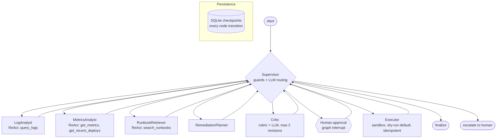

# IncidentOps

A multi-agent incident-triage system. A **supervisor** delegates to **specialist agents** (logs, metrics,
runbook RAG), a **planner** proposes a fix, a **critic** reviews it, a **human approves**, and an
**executor** applies it in a sandbox and verifies. State is **checkpointed** in SQLite, so a run survives
a `kill -9` and can wait days for approval.

MIT licensed. Python 3.11+. Built on LangGraph (Google ADK port scaffolded in `src/incidentops/adk_port/`).



## Quickstart

```bash
pip install -e ".[dev]"
incidentops scenarios                         # list the 10 synthetic incidents
incidentops run --scenario 7 --live           # DNS failure (high risk) -> pauses for approval
incidentops approve <incident-id>             # or --reject, or --edit plan.json
incidentops trace <incident-id>               # replay thoughts/actions/observations
incidentops run --scenario 3 --live --auto-approve
incidentops eval                              # writes evals/RESULTS.md
python scripts/crash_demo.py                  # hard-kill the process mid-run, resume from checkpoint
pytest --cov=incidentops
```

Default LLM is the offline **FakeLLM**. For a real model: `pip install -e ".[anthropic]"` (or `openai`, `gemini`),
set the provider's API key env var, and pass `--llm anthropic|openai|gemini`. Set `INCIDENTOPS_MODEL` to
choose the model. Never hardcode keys. The real-provider adapters are thin and not exercised by the offline tests.

## Important honesty note

`FakeLLM` is a rule-based stand-in (keyword and threshold rules), **not** a language model. It makes the system
deterministic and testable offline. The 100% numbers below prove the **plumbing** works (routing, state,
resilience, checkpoint recovery, critic rubric). They say nothing about how a real LLM performs on
ambiguous incidents. Run `incidentops eval --llm <provider>` and report those numbers for real claims.

## Eval results (FakeLLM, 10 scenarios)

| Metric | Value |
|---|---|
| Root-cause accuracy | 100% |
| Resolved (verified in sandbox) | 100% |
| Plan safety (no execution without approval) | 100% |
| Avg tool calls / incident | 4.0 |
| Avg supervisor steps / incident | 9.4 |
| Critic catch rate on injected bad plans | 60/60 |
| Critic false positives on good plans | 0/10 |
| Recovery after crash (resume from checkpoint) | 10/10 |

Full table and per-scenario rows: [`evals/RESULTS.md`](evals/RESULTS.md).

## What is implemented (milestones)

| # | Milestone | Where |
|---|---|---|
| 1 | Typed state, FakeLLM, mock tools, 10 scenarios | `state.py`, `llm/fake.py`, `tools/`, `scenarios/` |
| 2 | ReAct specialists | `agents/react.py`, `agents/analysts.py` |
| 3 | Supervisor + all specialists | `agents/supervisor.py`, `graph.py` |
| 4 | Critic loop (max 2 revisions) | `agents/critic.py` |
| 5 | Checkpointing, human approval, resume | `graph.py`, `app.py` |
| 6 | Resilience: retry/backoff/jitter, breaker, budgets | `resilience.py`, `agents/supervisor.py` |
| 7 | Eval harness + results | `evals/harness.py` |
| 8 | CLI, Docker, CI, README, MIT | `cli.py`, `Dockerfile`, `.github/` |
| 9 | Google ADK port | **scaffold only**, `adk_port/agent.py` (untested) |

## Design decisions and trade-offs

- **Supervisor = deterministic guards + LLM choice.** `allowed_next()` is a pure function of state that decides what
  is *legal* (the executor is unreachable before critic approval and human approval). The LLM only picks among legal
  options, and is only called when there is a real choice. Cheaper, and it cannot skip safety steps.
- **Least-privilege specialists.** Each analyst sees only its own tools: smaller prompts, easier to evaluate per role.
  Cost: more LLM calls than a single agent, and coordination can fail (the supervisor handles that).
- **Critic = deterministic rubric + LLM second opinion.** The LLM can add concerns but can never override a
  rubric failure, so it cannot rubber-stamp a bad plan. The red-team eval injects six kinds of bad plans.
- **State is a TypedDict of JSON values**, validated by pydantic models at every write. Plain JSON keeps any
  checkpointer happy and makes `resume` trivial.
- **Sync checkpoint durability.** LangGraph 1.x persists checkpoints asynchronously by default; a `kill -9` could lose
  the latest step. `durability="sync"` fixes that (found by the real kill test in `tests/test_hard_kill.py`).
- **Idempotent executor** via a sqlite-backed key (`incident|action|params|scope`), so a re-run after a crash
  cannot apply an action twice. Dry-run is the default.
- **Budgets count active time**, not wall-clock, so a plan waiting days for a human does not trip the time budget.
- **Specialist failure never crashes the graph:** exceptions become entries in `errors[]`, the specialist is marked
  done, and the supervisor routes around it or escalates (scenario 9: log tool down; scenario 10: logs return noise).
- **Mocked tools** give deterministic evals and safety. Real integrations would implement the same `ToolBox` methods.
- **BM25 runbook retrieval** keeps the project dependency-light; swap in Chroma/FAISS embeddings behind
  `RunbookRetriever.search`.

## Known limitations

- Circuit-breaker state is in-process (resets on restart). A production system would share it (Redis).
- Scenarios are synthetic and clean; real telemetry is messier. The retrieval index has 10 runbooks.
- Only one root cause per incident; no multi-fault reasoning.
- The ADK port is a scaffold; the LangGraph version is the tested one.

## Layout

```
src/incidentops/  state.py graph.py app.py cli.py resilience.py deps.py trace.py config.py
                  agents/ (supervisor analysts react planner critic executor prompts)
                  llm/ (base fake providers)  tools/ (mock catalog runbooks sandbox)
                  evals/harness.py  adk_port/
scenarios/ runbooks/ evals/ tests/ docs/ scripts/
```

See `docs/architecture.md`, `docs/research.md` (papers) and `docs/INTERVIEW.md` (how to present this).

## License

MIT, see [LICENSE](LICENSE). Replace `<Your Name>` in LICENSE with your name.
